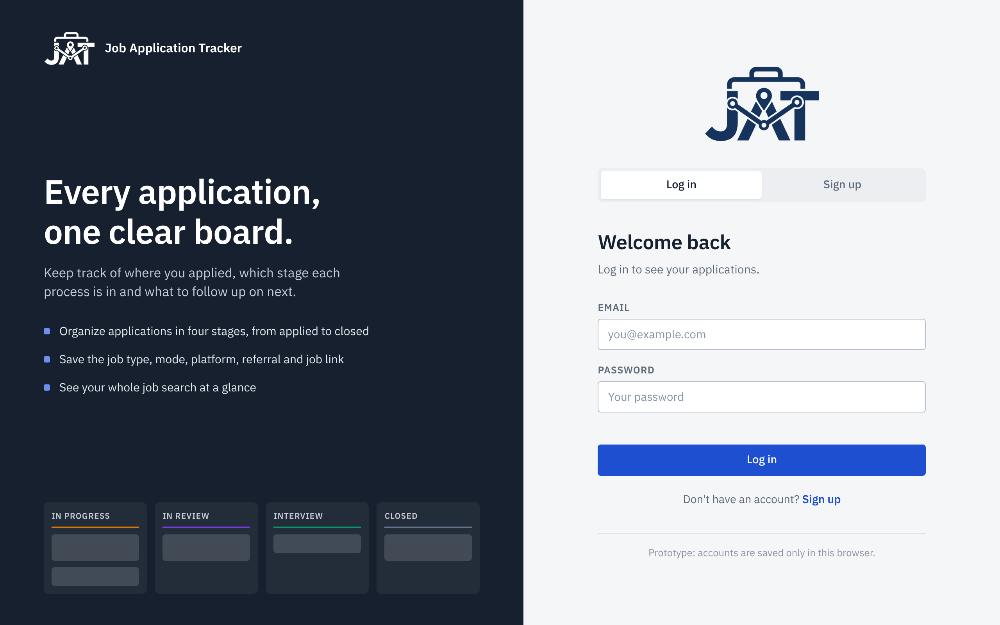

<p align="center"></p>

# Job Application Tracker

A web dashboard to organize and follow up on job applications, from the moment you apply until the process is closed.

> Web Programming and Design project.

🔗 **Live demo:** <https://al3mf.github.io/Job-Application-Tracker/>


---

## Table of contents

- [About](#about)
- [Features](#features)
- [Screenshots](#screenshots)
- [Accounts](#accounts)
- [Dashboard](#dashboard)
- [Application fields](#application-fields)
- [Getting started](#getting-started)
- [Project structure](#project-structure)
- [Tech stack](#tech-stack)
- [Roadmap](#roadmap)
- [Team](#team)

---

## About

Looking for a job or internship means sending many applications through different platforms, and it is easy to lose track of where you applied, which stage each one is in, and who referred you. **Job Application Tracker** puts all of that in one board so you can see your whole job search at a glance.

## Features

- **Start screen** with **Log in** and **Sign up**. Each account sees only its own applications, and the dashboard is only available after logging in.
- **Kanban board** with four stages: In Progress, In Review, Interview and Closed.
- **Starts empty**: the board has no sample data, you add your own applications.
- **+ New Application** button that opens a form to register a new application. Every dropdown starts on **"-"**, so you must pick a value before saving.
- **Job link** (optional) to save the URL of the job posting and open it later from the details menu.
- **Application details**: click a card to open a menu with all its data.
- **Status changes only from the details menu**, so cards can't be moved by accident.
- **Delete** an application from its details menu (asks for confirmation).
- **Platform icons** for "Applied via" (LinkedIn, Indeed, Handshake, Glassdoor, company website, email, career fair).
- **Counters** on each column showing how many applications it holds.
- **Tags** on each card for job type, job mode, platform and referral.
- **Saved in the browser** with `localStorage`, so data stays after reloading the page.
- **Responsive** layout: columns stack vertically on phones.

## Screenshots



| Dashboard | Application details |
| --- | --- |
|  |  |

## Accounts

The first screen (`index.html`) lets you **sign up** with your name, email and password, or **log in** if you already have an account. After logging in you go to the dashboard, where your name and a **Log out** button appear in the top bar.

> ⚠️ **Prototype only.** There is no server yet: accounts and applications are saved in your browser's `localStorage`, and passwords are stored as a SHA-256 hash. This keeps the data of different people on the same browser apart, but it is **not real security**, and your account won't exist on another device or browser. A real version needs a backend (see [Roadmap](#roadmap)).

## Dashboard

| Column | Meaning |
| --- | --- |
| 🟠 **In Progress** | You are preparing or just sent the application. |
| 🟣 **In Review** | The company is reviewing your application. |
| 🟢 **Interview** | You have been invited to one or more interviews. |
| ⚫ **Closed** | The process ended (offer, rejection or withdrawn). |

To move an application to another stage, click its card, choose the new **Status** and press **Save**.

## Application fields

When you click **+ New Application**, the form asks for the following. Every field except the job link is required, and every dropdown starts empty (**-**).

| Field | Type | Options |
| --- | --- | --- |
| Job position | Text | — |
| Company | Text | — |
| Job link | URL (optional) | Link to the job posting |
| Job type | Dropdown | Full-time, Part-time, Internship |
| Job mode | Dropdown | Hybrid, Remote, On-site |
| Application date | Date | Defaults to today |
| Referral | Dropdown | Yes, No |
| Applied via | Dropdown | LinkedIn, Indeed, Handshake, Glassdoor, Company website, Email, Career fair, Other |
| Status | Dropdown | In Progress, In Review, Interview, Closed |

## Getting started

No installation or build step is needed.

1. Clone the repository:

   ```bash
   git clone https://github.com/Al3mf/Job-Application-Tracker.git
   ```

2. Open `index.html` in your browser and create an account.

Optionally, serve it locally (for example with the VS Code **Live Server** extension, or):

```bash
python3 -m http.server 8000
```

Then open <http://localhost:8000>.

> To delete all your data at once, clear the site's `localStorage` from your browser's developer tools.

## Project structure

```
Job-Application-Tracker/
├── index.html      # Start screen: log in / sign up
├── login.js        # Start screen logic: tabs, validation, log in and sign up
├── dashboard.html  # Dashboard: top bar, board columns, New Application and details menus
├── app.js          # Dashboard logic: rendering, forms, details menu, icons, per-user data
├── auth.js         # Accounts and session (shared by both pages)
├── styles.css      # Styles for every page
├── assets/         # Logo (navy for light backgrounds, white for dark ones)
├── docs/           # Screenshots used in this README
└── README.md
```

## Tech stack

- **HTML5**: page structure and the native `<dialog>` element for the form.
- **CSS3**: Grid and Flexbox layout, CSS variables, media queries.
- **IBM Plex Sans** font (Google Fonts).
- **JavaScript (vanilla)**: DOM manipulation, form validation, `localStorage`, Web Crypto API (password hashing).
- **Inline SVG** icons for the application platforms.

## Roadmap

- [x] Dashboard with four columns
- [x] New Application form
- [x] Application details menu with status update
- [x] Platform icons for "Applied via"
- [x] Published with GitHub Pages
- [x] Start screen with log in / sign up (browser-only prototype)
- [x] Job posting link
- [ ] Edit the other fields of an application
- [ ] Search and filters (by company, job type, platform…)
- [ ] Notes per application
- [ ] Import applications from the LinkedIn data export (CSV)
- [ ] Statistics (applications per week, response rate)
- [ ] Backend with real user accounts (data synced across devices)

## Team

| Name | Role |
| --- | --- |
| Alex | Developer |
| _Add your name_ | _Role_ |
